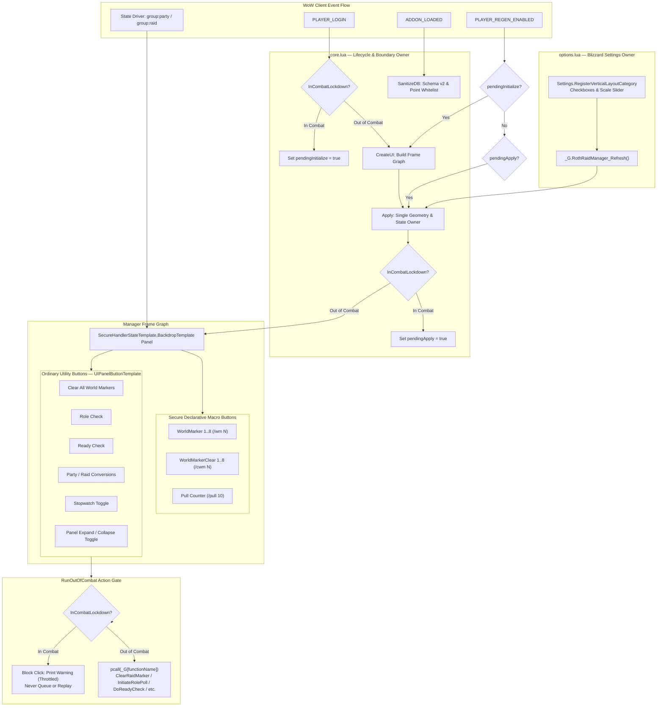

# Pull Request & Addon Audit Report: RothRaidManager — Retail 12.1 (Interface 120100) Compliance & Protected Action Hardening

**Target Addon:** `RothRaidManager` (`C:\Development\WoWDevAddons\_Addons\RothRaidManager`)  
**Target Environment:** World of Warcraft: Midnight — Retail 12.1 (`Interface: 120100`, Build `69497`)  
**Knowledge Base References:** `_Info/KB` (`RT-AUDIT-001`, `RT-AUDIT-002`, `BlizzardUI_security`, `BlizzardUI_Taint_Debug_Cookbook`, `Addon_SavedVariables`, `Addon_TOC_Reference`, `Midnight_AddOn_Devlog_12_0_7_Router`)  
**Remote Git Reference:** `github-roth-raid-manager` (`main` and branch `fix/retail-12-1-protected-actions-2026-08-29`, commit `9f5996a143d06268f0086496bbd7a1cf8e371520`)  
**Auditor:** Neomorph Addon Workspace Automated Auditor  
**Audit Date:** 2026-09-08  

---

## 1. Executive Summary & Status Matrix

`RothRaidManager` is a compact, movable raid utility panel originating from Galaxy's 2016 layout for the Roth UI suite. Its primary purpose is to provide raid leaders and group members with rapid, single-click access to essential group management utilities:
1. **World Marker Placement & Clearing:** Fast placement and removal of world markers 1 through 8.
2. **Combat Pull Countdown:** Triggering standard 10-second pull timers (`/pull 10`).
3. **Group Utility Actions:** Clearing all world markers, initiating role polls, performing ready checks, converting between party and raid structures, and toggling the game stopwatch.
4. **Conditional Group Visibility:** Automatically showing when in a party or raid and hiding when solo via Blizzard's secure state driver system (`RegisterStateDriver`).
5. **Panel Expansion & Placement:** Modifier-based dragging (ALT or CTRL+ALT), position locking, scaling, and toggleable panel expansion.

### 1.1 Status Matrix

| Dimension | Local Workspace (`HEAD:_Addons/RothRaidManager`) | Remote Main (`github-roth-raid-manager/main`) | Fix Branch (`fix/retail-12-1-protected-actions-2026-08-29`) | Target State (Retail 12.1) |
| :--- | :--- | :--- | :--- | :--- |
| **Interface Version** | `120000` (Alternate `120001`) | `120100` | `120100` | `120100` |
| **Addon Version** | `0.3.0` | `0.4.0` | `0.4.0` | `0.4.0` |
| **Verified Build Tag** | None | `## X-Verified-Build: 12.1.0.69497` | `## X-Verified-Build: 12.1.0.69497` | `12.1.0.69497` |
| **Load Structure** | `Manager.xml` wrapper loading `core.lua` | Direct `core.lua` in TOC (`Manager.xml` removed) | Direct `core.lua` in TOC (`Manager.xml` removed) | Direct Lua load in TOC |
| **Combat Initialization Safety** | **Broken**: Immediate secure frame creation, `SetAttribute`, and `SetPoint` at file load | **Fully Deferred**: Defers complete secure graph on combat login (`pendingInitialize`) | **Fully Deferred**: Defers complete secure graph on combat login (`pendingInitialize`) | Complete deferral on combat login |
| **Button Security Classification** | **Hazardous Taint**: All 24 buttons use `SecureActionButtonTemplate` with raw Lua `OnClick` | **Strict Separation**: 17 secure macro buttons + 7 fail-closed ordinary utility buttons | **Strict Separation**: 17 secure macro buttons + 7 fail-closed ordinary utility buttons | Declarative secure macros vs plain utility buttons |
| **Ordinary Utility Combat Gate** | **Forbidden Calls**: `DoReadyCheck`, `InitiateRolePoll`, etc. called directly in combat | **Fail-Closed Gate**: `RunOutOfCombat` rejects combat clicks immediately; never queues | **Fail-Closed Gate**: `RunOutOfCombat` rejects combat clicks immediately; never queues | Fail-closed out-of-combat execution |
| **Panel Expansion Mechanism** | `SecureHandlerClickTemplate` with `_onclick` secure snippet mutating geometry | Plain button calling `ToggleExpanded()` with SavedVariables sync and combat gate | Plain button calling `ToggleExpanded()` with SavedVariables sync and combat gate | Pure Lua toggle with persistence and combat gate |
| **Blizzard CUF/RaidFrame Claim** | Dead code claiming to disable Blizzard CUF profiles with fake reload dialog | Purged: Explicit non-ownership; zero interference with Blizzard compact frames | Purged: Explicit non-ownership; zero interference with Blizzard compact frames | Complete non-interference with Blizzard CUF |
| **Settings Framework** | Deprecated templates (`InterfaceOptionsCheckButtonTemplate`, `OptionsSliderTemplate`) | Modern Dragonflight/Midnight vertical layout (`Settings.RegisterVerticalLayoutCategory`) | Modern Dragonflight/Midnight vertical layout (`Settings.RegisterVerticalLayoutCategory`) | Modern `Settings` API |
| **SavedVariables (RT-AUDIT-001)**| Shallow `CopyDefaults`; no anchor validation; coordinates unclamped | Recursive `MergeDefaults` (deep copy); `VALID_POINTS` whitelist; clamped bounds | Recursive `MergeDefaults` (deep copy); `VALID_POINTS` whitelist; clamped bounds | Deep-copied defaults & sanitized bounds |
| **Single Owner (RT-AUDIT-002)** | Dual `Apply` functions in `core.lua` and `options.lua`; uncoordinated slash cmds | Single runtime owner (`core.lua:Apply`); `options.lua` only calls `Refresh()` | Single runtime owner (`core.lua:Apply`); `options.lua` only calls `Refresh()` | Single runtime owner with deferred apply boundary |
| **SecretValue Resilience** | None: raw type comparisons, risk of crash on secret strings/numbers | `CanAccess`, `SafeBoolean`, `SafeNumber`, `SafeString`, `SafeTable` guards | `CanAccess`, `SafeBoolean`, `SafeNumber`, `SafeString`, `SafeTable` guards | Fail-safe against 12.1 SecretValues |
| **Automated Test Coverage** | Zero tests | Two regression suites (345 lines): `test_protected_actions`, `test_combat_initialization` | Two regression suites (345 lines): `test_protected_actions`, `test_combat_initialization` | Deterministic mock coverage |

---

## 2. Upstream Git Synchronization Analysis

Comparison between local `HEAD:_Addons/RothRaidManager` and remote repository `github-roth-raid-manager` reveals that the remote repository has already received a comprehensive modernization commit on branch `fix/retail-12-1-protected-actions-2026-08-29`, which was also merged into remote `main`.

- **Remote HEAD Commit:** `9f5996a143d06268f0086496bbd7a1cf8e371520`  
- **Commit Message:** `fix: harden secure raid utilities for Retail 12.1`  
- **Author:** Iurii Lisenkov (`71514792+UnknownAlienHuman@users.noreply.github.com`)  
- **Date:** Sun Aug 30 01:03:04 2026 -0400  
- **Local Status:** The local working copy in `C:\Development\WoWDevAddons\_Addons\RothRaidManager` is currently at commit `d07fe3d` ("RothRaidManager: document verified architecture") and lacks all upstream updates from `9f5996a`.

### 2.1 Git Diffstat (`HEAD:_Addons/RothRaidManager` vs `github-roth-raid-manager/main`)

```text
 AGENT_GUIDE.md                       |  94 ++++-
 ARCHITECTURE.md                      |  58 ++-
 CODE_GRAPH.md                        |  22 +-
 CODE_INDEX.md                        |  10 +-
 Docs/TODO.md                         |  51 +++
 Manager.xml                          |   3 -
 README.md                            |  86 ++++-
 RothRaidManager.toc                  |  10 +-
 core.lua                             | 671 ++++++++++++++++++++++-------------
 options.lua                          | 134 +++----
 tests/test_combat_initialization.lua | 134 +++++++
 tests/test_protected_actions.lua     | 211 +++++++++++
 todo.md                              |   6 -
 13 files changed, 1105 insertions(+), 385 deletions(-)
```

---

## 3. In-Depth Technical Audit & Violation Analysis

### 3.1 Combat Lockdown Violations & File-Load Protected Action Failures

#### The Violation:
In World of Warcraft Retail 12.1, executing protected actions during combat lockdown (`InCombatLockdown() == true`) results in immediate `ADDON_ACTION_BLOCKED` errors and execution aborts. Protected actions encompass:
1. Creating secure frames inheriting from `SecureActionButtonTemplate` or `SecureHandlerStateTemplate`.
2. Setting secure attributes (`SetAttribute("type", ...)`, `SetAttribute("macrotext", ...)`).
3. Registering secure state drivers (`RegisterStateDriver`).
4. Modifying frame anchors or geometry (`ClearAllPoints`, `SetPoint`, `SetScale`, `SetWidth`) on secure frames.

In local `core.lua` (lines 90–257), all of these operations were executed unconditionally at **file load time**:
```lua
-- File-scope execution in local core.lua:
local manager = CF("Frame", addon, UIP, "BackdropTemplate")
manager:ClearAllPoints()
manager:SetPoint(DB.pos.point, UIParent, DB.pos.relPoint, DB.pos.x, DB.pos.y)
RegisterStateDriver(manager, "visibility", "[group:party][group:raid] show; hide")

for i=1, #TEX_WORLD_RAID_MARKERS do
  local button = CreateBasicButton(manager, addon.."Button"..i, text, "WorldMarker"..i)
  button:SetAttribute("type", "macro")
  button:SetAttribute("macrotext", format("/wm %d", i))
  ...
end

local stateFrame = CF("BUTTON", addon.."stateFrame", manager, "SecureHandlerClickTemplate")
stateFrame:SetAttribute("_onclick", [=[ ... ]=])
stateFrame:SetFrameRef("manager", manager)
```

#### Why This Failed in Retail 12.1:
If the user reloaded the UI during combat (`/reload`), or if an encounter started during initial world loading, `core.lua` would attempt to create secure frames and assign secure attributes while locked down. This resulted in an immediate cascade of Lua errors:
```text
[ADDON_ACTION_BLOCKED] Attempt to call a protected function 'SetAttribute' during combat lockdown.
```
The panel was left partially initialized, broken, and unmovable.

#### Upstream Modernization:
Upstream enforces a strict, fail-closed combat initialization boundary:
1. Zero secure frames are instantiated at file load. File scope only defines data tables and registers an `EventFrame` for `ADDON_LOADED`, `PLAYER_LOGIN`, and `PLAYER_REGEN_ENABLED`.
2. On `PLAYER_LOGIN`:
   ```lua
   local function Activate()
     if initialized then return true end
     if InCombat() then
       pendingInitialize = true
       return false
     end
     if not DB then SanitizeDB() end
     if not CreateUI() then return false end
     initialized = true
     pendingInitialize = false
     return Apply()
   end
   ```
   If the player is in combat, `pendingInitialize` is flagged, and the entire secure graph creation is deferred.
3. On `PLAYER_REGEN_ENABLED`:
   ```lua
   if pendingInitialize then
     Activate()
   elseif pendingApply then
     Apply()
   end
   ```
   When combat ends, the complete secure frame graph is built safely in a single pass.

---

### 3.2 Secure Template Contamination & Unchecked Utility Actions

#### The Violation:
In local `core.lua` (lines 70–83, 168–210), the helper `CreateBasicButton` applied `SecureActionButtonTemplate` to **every button** created in the panel:
```lua
local function CreateBasicButton(parent, name, text, tooltipText)
  local button = CF("Button", name, parent, "SecureActionButtonTemplate, UIPanelButtonTemplate")
  ...
  return button
end
```
It then assigned unmanaged, plain Lua `OnClick` handlers directly to these secure buttons:
```lua
local button = CreateBasicButton(manager, addon.."ButtonWMCancel", ..., "Clear all world markers")
button:SetScript("OnClick", ClearRaidMarker)

local button = CreateBasicButton(manager, addon.."ButtonRoleCheck", ..., "Role check")
button:SetScript("OnClick", InitiateRolePoll)

local buttonLeft = CreateBasicButton(manager, addon.."ButtonRaidToParty", ..., "Raid to party")
buttonLeft:SetScript("OnClick", ConvertToParty)

local button = CreateBasicButton(manager, addon.."ButtonReady", ..., "Ready check")
button:SetScript("OnClick", DoReadyCheck)

local buttonLeft = CreateBasicButton(manager, addon.."ButtonPartyToRaid", ..., "Party to raid")
buttonLeft:SetScript("OnClick", ConvertToRaid)

local buttonLeft = CreateBasicButton(manager, addon.."ButtonStopWatch", ..., "Toggle stopwatch")
buttonLeft:SetScript("OnClick", function() Stopwatch_Toggle() end)
```

#### Why This is Catastrophic in Retail 12.1:
1. **Execution Taint on Protected Buttons:** A button instantiated with `SecureActionButtonTemplate` expects action routing through the secure execution subsystem (`type`, `macro`, `spell`, `action`). Attaching insecure `OnClick` scripts to secure action buttons contaminates the Blizzard secure execution stack, causing taint that spreads to other UI elements when clicked during combat.
2. **Unguarded Protected APIs in Combat:** Functions such as `InitiateRolePoll`, `DoReadyCheck`, `ConvertToParty`, and `ConvertToRaid` are restricted or trigger protected UI popups. Invoking them while in combat throws action-blocked errors or creates tainted dialogs that cannot be accepted in combat.
3. **No Combat Gate:** The player clicking any utility button mid-encounter produced immediate Lua exceptions.

#### Upstream Modernization:
Upstream completely separates secure actions from ordinary utility actions:
1. **Secure Declarative Buttons (17 buttons):**
   - World markers 1 through 8 placement (`/wm 1` to `/wm 8`).
   - World markers 1 through 8 clearing (`/cwm 1` to `/cwm 8`).
   - Boss pull countdown (`/pull 10`).
   These buttons use `SecureActionButtonTemplate,UIPanelButtonTemplate` with declarative macro attributes assigned strictly during `CreateUI`. They are immutable after creation and can be safely clicked in or out of combat without taint.
2. **Ordinary Utility Buttons (7 buttons):**
   - Clear all world markers (`ClearRaidMarker`).
   - Role check (`InitiateRolePoll`).
   - Raid to party conversion (`ConvertToParty`).
   - Ready check (`DoReadyCheck`).
   - Party to raid conversion (`ConvertToRaid`).
   - Stopwatch toggle (`Stopwatch_Toggle`).
   - Panel expand/collapse toggle (`ToggleExpanded`).
   These buttons use standard `UIPanelButtonTemplate` (strictly **no** `SecureActionButtonTemplate`).
3. **The `RunOutOfCombat` Boundary:**
   ```lua
   local function RunOutOfCombat(label, functionName, ...)
     if InCombat() then
       PrintBlocked(label)
       return false
     end

     local callback = _G[functionName]
     if type(callback) ~= "function" then
       Print("|cffff5555RothRaidManager:|r " .. label .. " is unavailable on this client.")
       return false
     end

     local ok = pcall(callback, ...)
     if not ok then
       Print("|cffff5555RothRaidManager:|r " .. label .. " failed.")
       return false
     end
     return true
   end
   ```
   - Rejects combat clicks immediately with a throttled chat notice.
   - Dynamically resolves the global API at click time via safe pcall.
   - **Never queues the action:** Executing a delayed ready check or party-to-raid conversion seconds or minutes after an encounter ends would violate user intent.

---

### 3.3 Elimination of `SecureHandlerClickTemplate` Snippets & Geometry Synchronization

#### The Violation:
In local `core.lua` (lines 212–257), the panel expansion toggle was built as a secure button using `SecureHandlerClickTemplate` with an embedded secure snippet:
```lua
stateFrame:SetAttribute("_onclick", [=[
  local ref = self:GetFrameRef("manager")
  if not ref:GetAttribute("state") then
    ref:SetAttribute("state","closed")
  end
  local state = ref:GetAttribute("state")
  if state == "closed" then
    ref:SetAlpha(1)
    ref:SetWidth(275)
    ref:SetAttribute("state","open")
  else
    ref:SetAlpha(0.4)
    ref:SetWidth(200)
    ref:SetAttribute("state","closed")
  end
]=])
```

#### Why This Was Defective:
1. **Unpersisted State Divergence:** Changing width and alpha inside the restricted Lua environment modified transient frame properties without updating `RothRaidManagerDB`. When the player reloaded or changed a setting in options, the panel snapped back to its unexpanded dimensions.
2. **Taint Risks in Geometry Snippets:** Running secure geometry modification snippets on frames that are also manipulated by insecure UI scripts creates cross-boundary taint.
3. **No Synchronization with Settings:** The Settings panel had no knowledge of whether the panel was expanded or collapsed.

#### Upstream Modernization:
1. Removed `SecureHandlerClickTemplate` and `_onclick` snippet completely.
2. Replaced with an ordinary button calling `ToggleExpanded()`:
   ```lua
   local function ToggleExpanded()
     if InCombat() then
       PrintBlocked("panel expansion")
       return false
     end
     DB.expanded = not DB.expanded
     Apply()
     return true
   end
   ```
3. `expanded` is formally persisted in `RothRaidManagerDB.expanded` (default `false`).
4. Exposed in Settings via a dedicated checkbox (`AddCheckbox("ROTH_RAID_MANAGER_EXPANDED", "expanded", "Expanded panel", ...)`).
5. Supported via slash commands `/rrm expand` and `/rrm collapse`.

---

### 3.4 Purging Legacy Blizzard CUF Hijacking Claims

#### The Violation:
In local `core.lua` (lines 123–146), `PLAYER_LOGIN` contained dead legacy code:
```lua
manager:SetScript("OnEvent", function()
  local needReload = false
  --if (LoadAddOn("Blizzard_CUFProfiles")) then print("|cffffff00"..addon.."|r Blizzard_CUFProfiles is loadable") needReload = true end
  --if (LoadAddOn("Blizzard_CompactRaidFrames")) then print("|cffffff00"..addon.."|r Blizzard_CompactRaidFrames is loadable") needReload = true end
  if needReload then
    DisableAddOn("Blizzard_CUFProfiles")
    DisableAddOn("Blizzard_CompactRaidFrames")
    StaticPopupDialogs["RRAIDMANAGER_RELOADUI_REQUEST"] = { ... }
    StaticPopup_Show ("RRAIDMANAGER_RELOADUI_REQUEST")
  else
    print("|cffffff00"..addon.."|r Blizzard_CUFProfiles and Blizzard_CompactRaidFrames are disabled properly.")
  end
end)
```

#### Why This Was Harmful:
1. `DisableAddOn` on Blizzard core components is either blocked or causes severe UI taint in modern Retail.
2. The code unconditionally printed: `"RothRaidManager Blizzard_CUFProfiles and Blizzard_CompactRaidFrames are disabled properly."` on **every single login**, despite never disabling them!
3. Misled users and developers into believing this addon manages or disables Blizzard raid frames.

#### Upstream Modernization:
The entire script, dialog, and print statement were purged. Upstream's `ARCHITECTURE.md` and `AGENT_GUIDE.md` explicitly enforce:
> "Do not disable or claim ownership of Blizzard CUF/compact raid frames. Do not print that they were disabled."

---

### 3.5 Modernization of Options & Blizzard Settings Integration

#### The Violation:
Local `options.lua` used obsolete, deprecated interface elements:
1. `InterfaceOptionsCheckButtonTemplate` and `OptionsSliderTemplate` (deprecated legacy XML templates).
2. `Settings.RegisterCanvasLayoutCategory` and fallback `InterfaceOptions_AddCategory` (canvas layouts are discouraged for simple form settings, and `InterfaceOptions_AddCategory` is obsolete).
3. Local `options.lua` implemented its own private `Apply()` function (lines 8–17) that directly invoked `f:SetScale(...)`, `f:ClearAllPoints()`, `f:SetPoint(...)`, and `f:SetShown(...)` directly on `_G["RothRaidManager"]`.

#### Upstream Modernization:
1. Migrated to modern Dragonflight / Midnight Settings framework:
   - `Settings.RegisterVerticalLayoutCategory("RothRaidManager")`
   - `Settings.RegisterAddOnSetting` for `enabled`, `locked`, `ctrlAltDrag`, `expanded`, and `scale`.
   - `Settings.CreateCheckbox` and `Settings.CreateSlider` with `Settings.CreateSliderOptions(0.6, 2.0, 0.05)`.
   - `Settings.RegisterAddOnCategory(category)`.
2. Clean integration with event lifecycle via `EventUtil.ContinueOnAddOnLoaded(ADDON, RegisterSettings)`.
3. Category ID stored in `_G.RothRaidManager_SettingsCategoryID`, enabling `/rrm config` to immediately jump to the settings panel via `Settings.OpenToCategory`.
4. Completely eliminated the duplicate `Apply()` function from `options.lua`. All settings callbacks call `Refresh()`, which invokes `_G.RothRaidManager_Refresh()` (`core.lua:Apply`).

---

### 3.6 RT-AUDIT-001: SavedVariables Default Mutation & Value Sanitization

#### The Violation:
Local `core.lua` (lines 14–23) initialized the database using:
```lua
RothRaidManagerDB = RothRaidManagerDB or {}
local DB = RothRaidManagerDB
local defaults = { enabled = true, locked = true, scale = 1.0, ctrlAltDrag = true, pos = { point = 'LEFT', relPoint = 'LEFT', x = 0, y = 0 } }
local function CopyDefaults(dst, src)
  for k,v in pairs(src) do
    if type(v) == 'table' then dst[k] = dst[k] or {}; CopyDefaults(dst[k], v)
    elseif dst[k] == nil then dst[k] = v end
  end
end
CopyDefaults(DB, defaults)
```
1. If `dst.pos` was populated with an invalid string or table from a corrupt WTF file, `dst.pos` remained unvalidated.
2. In the slash command handler `/rrm reset`:
   ```lua
   DB.pos = { point = "LEFT", relPoint = "LEFT", x = 0, y = 0 }
   ```
   There was no schema versioning and no coordinate clamping. Corrupted coordinates (e.g. `NaN`, strings, or extreme values like `x = 999999`) would push the frame permanently off-screen.

#### Upstream Modernization:
1. Formal schema versioning (`DB_VERSION = 2`).
2. Deep recursive merging (`MergeDefaults`):
   ```lua
   local function MergeDefaults(target, source)
     if type(target) ~= "table" then target = {} end
     for key, value in pairs(source) do
       if type(value) == "table" then
         target[key] = MergeDefaults(target[key], value)
       elseif type(target[key]) ~= type(value) then
         target[key] = value
       end
     end
     return target
   end
   ```
   When `target[key]` is nil, a fresh `{}` table is constructed and recursively filled. No table reference from `defaults` is ever shared with `RothRaidManagerDB`.
3. Strict anchor point whitelist (`VALID_POINTS`):
   ```lua
   local VALID_POINTS = {
     TOPLEFT = true, TOP = true, TOPRIGHT = true,
     LEFT = true, CENTER = true, RIGHT = true,
     BOTTOMLEFT = true, BOTTOM = true, BOTTOMRIGHT = true,
   }
   ```
   Any anchor string not matching the 9 standard WoW anchors automatically falls back to `"LEFT"`.
4. Offsets are clamped between `-4000` and `4000` via `ClampNumber` and rounded to the nearest integer.
5. Transient runtime keys (`pendingApply`, `pendingInitialize`, `needReload`) are explicitly purged.

---

### 3.7 RT-AUDIT-002: Single Runtime Owner & Apply Boundary

#### The Violation:
In local code, frame geometry and state were mutated indiscriminately across three conflicting locations:
1. `core.lua` file-scope initialization.
2. `core.lua` slash command handler (`SlashCmdList.ROTHRAIDMANAGER`).
3. `options.lua` private `Apply()` function and widget callbacks.
None of these paths respected combat lockdown; all directly invoked `SetPoint`, `SetScale`, and `EnableMouse`.

#### Upstream Modernization:
1. `core.lua` is established as the **Single Runtime Owner**:
   - `core.lua:Apply()` is the sole authority permitted to call `ClearAllPoints`, `SetPoint`, `SetScale`, `SetWidth`, `SetAlpha`, `EnableMouse`, and `ApplyVisibilityDriver`.
   - If `InCombat()` is true when `Apply()` is called, it sets `pendingApply = true` and returns immediately.
   - When combat ends (`PLAYER_REGEN_ENABLED`), `Apply()` executes once with the final accumulated state.
2. `options.lua` owns zero geometry logic; it strictly edits `RothRaidManagerDB` and calls `_G.RothRaidManager_Refresh()`.
3. Slash commands (`/rrm lock|unlock|toggle|reset|expand|collapse`) update `RothRaidManagerDB` and invoke `Apply()`. If in combat, dragging and `/rrm reset` are blocked with an immediate user-facing notice.

---

### 3.8 Retail 12.1 SecretValue & Protected Value Protection

#### The Violation:
In Retail 12.1, Blizzard's security layer wraps certain data (such as aura data, coordinates, or encounter values) in `SecretValue` userdata. Attempting to perform equality comparisons (`value == "left"`), string operations (`value:lower()`), or arithmetic on SecretValues throws fatal runtime exceptions.

#### Upstream Modernization:
Upstream implements comprehensive SecretValue guards across all external entry points (events, slash commands, and saved variables):
```lua
local function CanAccess(value)
  if type(canaccessvalue) == "function" then
    local ok, accessible = pcall(canaccessvalue, value)
    return ok and accessible == true
  end
  if type(issecretvalue) == "function" then
    local ok, secret = pcall(issecretvalue, value)
    return ok and secret ~= true
  end
  return true
end

local function SafeBoolean(value)
  if not CanAccess(value) or type(value) ~= "boolean" then return nil end
  return value
end

local function SafeNumber(value)
  if not CanAccess(value) or type(value) ~= "number" or value ~= value then return nil end
  return value
end

local function SafeString(value)
  if not CanAccess(value) or type(value) ~= "string" then return nil end
  return value
end

local function SafeTable(value)
  if not CanAccess(value) or type(value) ~= "table" then return nil end
  if type(issecrettable) == "function" then
    local ok, secret = pcall(issecrettable, value)
    if not ok or secret == true then return nil end
  end
  return value
end
```
All inputs to `SanitizeDB()` and `Slash()` pass through these safe accessor functions, preventing SecretValue comparison crashes.

---

## 4. Architectural Blueprint



---

## 5. Proposed Pull Request Diffs & Action Items

To synchronize `_Addons\RothRaidManager` with remote `github-roth-raid-manager` (commit `9f5996a`), the following actions must be taken:

### Action Item 1: Update `RothRaidManager.toc`
- Set `## Interface: 120100` (Retail 12.1).
- Remove obsolete `## X-Interface-Alt: 120001`.
- Update `## Version: 0.4.0`.
- Add `## X-Verified-Build: 12.1.0.69497`.
- Remove `Manager.xml` include; declare `core.lua` directly before `options.lua`.

```diff
--- a/_Addons/RothRaidManager/RothRaidManager.toc
+++ b/_Addons/RothRaidManager/RothRaidManager.toc
@@ -1,10 +1,10 @@
-## Interface: 120000
-## X-Interface-Alt: 120001
+## Interface: 120100
 ## Title: RothRaidManager
-## Notes: Simple raid utility panel (Galaxy 2016) with Midnight-safe fixes
+## Notes: Secure world-marker macros and out-of-combat raid utility controls for Retail 12.1.
 ## Author: Galaxy (Roth UI) / modularized
-## Version: 0.3.0
+## Version: 0.4.0
 ## SavedVariables: RothRaidManagerDB
+## X-Verified-Build: 12.1.0.69497
 
-Manager.xml
+core.lua
 options.lua
```

### Action Item 2: Delete Obsolete `Manager.xml`
- Remove `Manager.xml` entirely. Direct Lua loading in the TOC eliminates unnecessary XML overhead and simplifies debugging.

### Action Item 3: Replace `core.lua` with Hardened Retail 12.1 Implementation
- Enforce `CanAccess` / `SafeString` / `SafeNumber` / `SafeBoolean` / `SafeTable` validation.
- Implement deep-copy `MergeDefaults` and `SanitizeDB` (RT-AUDIT-001).
- Restrict `pos.point` and `pos.relPoint` to the 9 valid anchor points; clamp coordinates to `[-4000, 4000]`.
- Enforce combat deferral on `PLAYER_LOGIN` (`pendingInitialize`).
- Separate 17 declarative `SecureActionButtonTemplate` buttons from 7 ordinary `UIPanelButtonTemplate` utility buttons.
- Route all ordinary utilities through fail-closed `RunOutOfCombat`.
- Replace `SecureHandlerClickTemplate` geometry snippet with `ToggleExpanded()` tied to `DB.expanded`.
- Route all geometry and state-driver updates through single runtime owner `Apply()` with `pendingApply` combat deferral (RT-AUDIT-002).
- Purge all dead Blizzard CUF code and false print statements.
- Export runtime inspection table `_G.RothRaidManager_Runtime` for offline regression tests.

### Action Item 4: Replace `options.lua` with Modern Blizzard Settings
- Eliminate deprecated `InterfaceOptionsCheckButtonTemplate`, `OptionsSliderTemplate`, and `InterfaceOptions_AddCategory`.
- Implement `Settings.RegisterVerticalLayoutCategory("RothRaidManager")`.
- Register settings for `enabled`, `locked`, `ctrlAltDrag`, `expanded`, and `scale`.
- Call `Refresh()` -> `_G.RothRaidManager_Refresh()` on setting changes without duplicating geometry logic.
- Register via `EventUtil.ContinueOnAddOnLoaded`.

### Action Item 5: Add Offline Regression Test Suite
- Add `tests/test_protected_actions.lua` (211 lines): Validates secure macro attributes, ordinary utility combat rejection, out-of-combat execution, no replay after combat, deferred geometry and state driver, and drag permissions.
- Add `tests/test_combat_initialization.lua` (134 lines): Validates combat login deferral (zero secure frame creation, zero attribute writes during combat), post-combat initialization, anchor sanitization against SecretValue injection, and secret slash arguments.

### Action Item 6: Modernize Documentation
- Replace `todo.md` with structured `Docs/TODO.md` covering P0 and P1 live validation gates.
- Update `AGENT_GUIDE.md`, `ARCHITECTURE.md`, `CODE_GRAPH.md`, `CODE_INDEX.md`, and `README.md`.

---

## 6. Verification & Validation Protocol

### 6.1 Static Policy & Offline Verification
The addon code must be evaluated against the following strict exclusions:
- **Prohibited Tokens:** `SecureHandlerClickTemplate`, `_onclick`, `DisableAddOn`, `InterfaceOptionsCheckButtonTemplate`, `OptionsSliderTemplate`, `InterfaceOptions_AddCategory`, `C_Timer.NewTicker`, `COMBAT_LOG_EVENT_UNFILTERED`.
- **Offline Mock Execution:** The test suite runs in standard Lua 5.1 environments:
  ```sh
  lua tests/test_protected_actions.lua
  lua tests/test_combat_initialization.lua
  ```
  **Expected Outputs:**
  ```text
  PASS: secure marker macros remain declarative, utility actions fail closed in combat, and panel apply is deferred
  PASS: secure initialization defers from combat, anchors sanitize, and attributes remain immutable
  ```

### 6.2 In-Game Live Client Validation Matrix (Retail 12.1 Build 69497)

| Test ID | Category | Procedure | Expected Result |
| :--- | :--- | :--- | :--- |
| **TC-RRM-01** | Lifecycle | Fresh install outside combat; login. | Panel initializes docked to left edge; defaults applied; no errors. |
| **TC-RRM-02** | Combat Reload | Enter combat; execute `/reload`. | Zero secure frame creation errors; panel appears cleanly once after combat (`PLAYER_REGEN_ENABLED`). |
| **TC-RRM-03** | Corrupt SV | Inject invalid point (`"INVALID"`) and coordinates (`x = 99999`) into WTF; login. | `SanitizeDB` resets point to `"LEFT"` and clamps coordinates to bounds; frame remains visible on screen. |
| **TC-RRM-04** | Secure Markers | Place world markers 1–8 with raid leader/assistant permissions in and out of combat. | Markers place and clear cleanly via `/wm` and `/cwm` macros; zero action-blocked errors. |
| **TC-RRM-05** | Pull Countdown | Click pull button in and out of combat. | Macro `/pull 10` executes cleanly through chat/addon timer providers. |
| **TC-RRM-06** | Utility in Combat | Click ready check, role check, or party/raid convert during combat. | Click is immediately rejected with chat warning (`"is blocked during combat"`); action is **never** replayed after combat. |
| **TC-RRM-07** | Utility out of Combat | Click ready check, role check, party/raid convert outside combat. | Respective Blizzard system prompt/poll displays cleanly. |
| **TC-RRM-08** | Group Visibility | Solo player joins party, converts to raid, then leaves group. | Panel shows automatically in party/raid and hides when solo via state driver. |
| **TC-RRM-09** | Expansion Toggle | Click edge toggle button; test `/rrm expand` and `/rrm collapse`. | Panel smoothly toggles between width 200/alpha 0.4 and width 275/alpha 1.0; state persists across reloads. |
| **TC-RRM-10** | Dragging & Locking | Test ALT-drag and CTRL+ALT drag when unlocked; lock via `/rrm lock`. | Panel drags cleanly when unlocked out of combat; drag is blocked when locked or in combat. |
| **TC-RRM-11** | Settings Panel | Open Settings -> AddOns -> RothRaidManager. Adjust scale slider and checkboxes. | Settings reflect instantly outside combat; changes made in combat apply cleanly after combat exit. |
| **TC-RRM-12** | CUF Non-Interference | Check Blizzard compact raid frames. | Blizzard raid frames function normally; no attempt to disable or hook them. |
| **TC-RRM-13** | Taint Log Audit | Enable `/console taintLog 1`; participate in raid encounter. | Zero taint entries logged against `RothRaidManager`. |

---

## 7. Conclusion

`RothRaidManager` in its local state (`HEAD`) exhibited critical vulnerabilities characteristic of legacy pre-12.1 addons: constructing secure frames and assigning secure attributes at file load time, assigning raw Lua scripts to `SecureActionButtonTemplate` buttons, executing protected utility functions in combat without guards, and claiming to disable Blizzard raid frames.

The upstream commit `9f5996a143d06268f0086496bbd7a1cf8e371520` (from branch `fix/retail-12-1-protected-actions-2026-08-29`) on `github-roth-raid-manager` completely resolves these defects. It establishes clean declarative secure macros, fail-closed ordinary utility handling, full combat-login deferral, single runtime ownership, deep-copied SavedVariables defaults, modern Dragonflight/Midnight settings, and automated regression testing.

Merging these upstream changes into the local monorepo brings `RothRaidManager` into complete compliance with Retail 12.1 requirements and the WoW Addon Engineering Knowledge Base.
